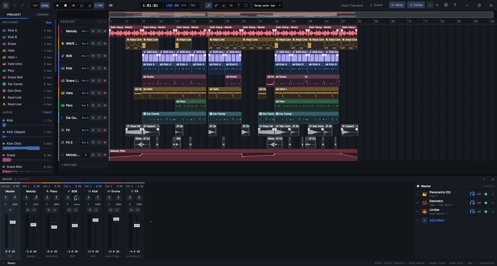

<p align="center"></p>
<h1 align="center">WAVE</h1>
<p align="center">A fast, FL-Studio-style DAW with a Rust audio engine. Free and open source.</p>
<p align="center">
  <a href="https://github.com/miskibin/wave-DAW/releases/latest"><b>Download</b></a> ·
  <a href="https://miskibin.github.io/wave-DAW/">Website and audio examples</a> ·
  <a href="docs/cli.md">Command line</a> ·
  <a href="docs/architecture.md">Architecture</a>
</p>



## Note from developer (This part is not AI SLOP)

- **2010:** I downloaded FL Studio for the first time and started making music.
- **2015:** I started music school: cello, guitar and piano (graduated in 2019).
- **2016–2022:** I sold beats to underground rappers in Poland (pop, true school, trap, love songs).
- Along the way I tried almost every genre (EDM, lo-fi, classical, my own pop songs), often with real instruments in my beats. I also run a YouTube channel and master the voice for it myself.
- **2022:** I joined Nokia, where I work on noise cancellation for telecom radios. That is a lot of DSP math, so I understand how sound works under the hood.

My whole life led me to this product, and with AI I can finally build it. Yes, the app is vibe-coded with claude Fable, but at least I know what the code is doing.

I now use WAVE for everything I used FL Studio for.

## What it does

- **Playlist and patterns.** Pattern, audio and automation clips on free lanes; slice, fade,
  reverse, normalise; every edit is one undo step.
- **Channel Rack and piano roll.** A step sequencer with swing and velocity, a piano roll for
  every pitched channel, and the computer keyboard or a MIDI keyboard as the instrument.
- **Instruments.** A two-oscillator wavetable [synth](docs/synth.md) with unison, a mod matrix
  and its own effects; [WAVE Keys](docs/keys.md), a sampled concert grand that ships inside the
  installer; one-shot sampler channels; a downloadable library of CC0 drum kits.
- **A mixer you can read.** Inserts with a 24-band dynamic EQ, compressor, FET compressor,
  [saturator](docs/saturator.md), delay, [reverb and limiter](docs/reverb-limiter-v2.md),
  de-esser, denoiser and more. Every effect has presets and draws what it is doing to the
  audio that is passing through.
- **Recording.** Loop recording with takes and comping, measured latency compensation,
  live monitoring.
- **Vocal tools.** A note-level pitch editor, Tune to Reference (pull a take onto a guide
  vocal), live pitch correction, a vocal rider and a one-click vocal chain.
- **VST3 effects and ASIO.** Plugins run with their own editor windows after a crash-proof
  scan; WASAPI and ASIO on Windows, ALSA on Linux.
- **A command line.** `wave` edits the open project live, with the same undo history, and
  bounces it offline. Scripts and AI agents can write a song and check the result.
- **English and Polish** interface, switched in Settings.

Performance is the first requirement: the audio callback never allocates or locks, moving a
knob never rebuilds the graph, and every moving picture in the interface is drawn on canvas
from one binary telemetry frame. See [`docs/architecture.md`](docs/architecture.md).

## Install

Download the installer from the [latest release](https://github.com/miskibin/wave-DAW/releases/latest).
The Windows build includes ASIO support (Settings → Audio → ASIO) and the WAVE Keys piano.
Linux packages are attached to the same release.

## Build from source

Prerequisites: Rust stable, Node 22 + pnpm, and on Linux the WebKitGTK/ALSA dev packages
(`libwebkit2gtk-4.1-dev libasound2-dev`).

```sh
pnpm --dir ui install
cargo install tauri-cli --version "^2"
cd app && cargo tauri dev
```

**ASIO (Windows):** build with the `asio` feature. It needs LLVM/Clang
(`winget install LLVM.LLVM`, then `LIBCLANG_PATH=C:\Program Files\LLVM\bin`); cpal downloads
the Steinberg SDK by itself.

```powershell
cd app; cargo tauri build --features asio
```

**WAVE Keys in your own build:** `node scripts/fetch-keys.mjs` downloads the piano (138 MB,
checksummed) into `app/resources/keys` so `tauri build` ships it. Without it the app offers to
download the piano the first time you add the instrument.

## The `wave` command line

It works as soon as the app has run once (open a new terminal). Full reference:
[`docs/cli.md`](docs/cli.md).

```sh
wave context --pretty                     # tracks, inserts, patterns, channels
wave channels --keys                      # add the WAVE Keys piano
wave pattern --id 2 --ch hat --steps "x.x. x.x. x.x5 x.x9"
wave add-fx --insert 6 --type reverb --preset 3
wave render --out check.wav --to 16       # offline bounce + level statistics
```

## Layout

| path | what |
| --- | --- |
| `crates/engine` | project model, ops + undo, sequencer, synth and piano voices, built-in DSP, mixer graph, recording, offline render, analysis |
| `crates/audio-io` | cpal devices: WASAPI / ASIO / CoreAudio / ALSA, duplex in/out |
| `crates/vst3-host`, `crates/plugin-windows`, `crates/plugin-scan` | VST3 effects as engine processors, crash-proof out-of-process scan, native editor windows |
| `crates/audio-file` | WAV/FLAC/OGG/MP3 decoding |
| `crates/session`, `crates/cli` | the local socket the CLI uses, and the CLI itself |
| `app` | Tauri shell: commands, library downloads, settings, CLI launcher |
| `ui` | SolidJS + TypeScript frontend (runs in a plain browser with a mock backend too) |
| `site` | the landing page published to GitHub Pages |

## Tests

```sh
cargo test --workspace
pnpm --dir ui test
cargo run -p wave-engine --example bench --release   # callback load, heavy mixer
```

## Licence

MIT or Apache-2.0. Third-party components and sample credits:
[`THIRD_PARTY_NOTICES.md`](THIRD_PARTY_NOTICES.md).
